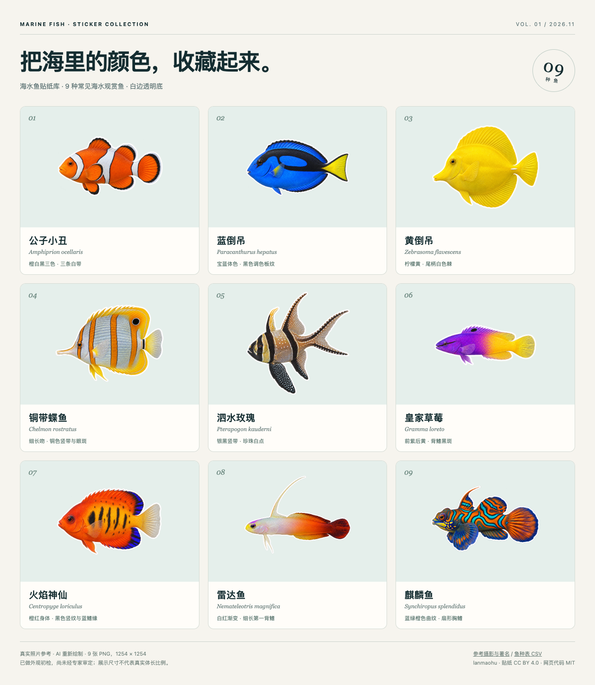

# 海水鱼贴纸库 · Marine Fish Stickers

**9 种常见海水观赏鱼，一种一张白边透明贴纸。** 附中文常用名、英文名、学名、参考照片、摄影师署名和生成提示词。

[在线画廊](https://lanmaohu.github.io/marine-fish-stickers/) · [下载全部贴纸与资料（ZIP）](https://github.com/lanmaohu/marine-fish-stickers/releases/download/v0.1.0/marine-fish-stickers-v0.1.0.zip) · [版本记录](https://github.com/lanmaohu/marine-fish-stickers/releases) · [English](#english)



由 [lanmaohu](https://github.com/lanmaohu) 发布。贴纸采用 **[CC BY 4.0](LICENSE.md)**：署名后可商用、修改和分享。网页与构建代码采用 MIT；第三方照片保留各自许可，见 [CREDITS.md](CREDITS.md)。

## 预览与下载

- **看全部：** [打开在线画廊](https://lanmaohu.github.io/marine-fish-stickers/)，可搜索中英文名、学名或科名，切换深浅背景，并对照真实参考照片。
- **下载一张：** 在在线画廊点击「下载 PNG」，或在下表打开原图保存。
- **下载整包：** [v0.1.0 素材包](https://github.com/lanmaohu/marine-fish-stickers/releases/download/v0.1.0/marine-fish-stickers-v0.1.0.zip)。下载包含 9 张 PNG、10 张参考照片、预览页、数据、提示词与署名许可，可离线浏览。
- **下载项目：** 使用 GitHub 的 Code → Download ZIP，或 `git clone https://github.com/lanmaohu/marine-fish-stickers.git`。
- **校验：** [下载包 SHA-256](downloads/SHA256SUMS.txt) · [单张 PNG SHA-256](data/stickers.sha256)。

所有贴纸为 **1254 × 1254 像素 PNG，含真实透明通道**。画面为完整单鱼、侧身朝左、白色描边；展示尺寸不代表真实体长。

## 鱼种目录

| 编号 | 中文常用名 | English | 学名 | 科 | 原图 |
| --- | --- | --- | --- | --- | --- |
| 01 | 公子小丑 | Ocellaris clownfish | *Amphiprion ocellaris* | [Pomacentridae](stickers/Pomacentridae/) | [PNG](stickers/Pomacentridae/Amphiprion_ocellaris.png?raw=true) |
| 02 | 蓝倒吊 | Palette surgeonfish | *Paracanthurus hepatus* | [Acanthuridae](stickers/Acanthuridae/) | [PNG](stickers/Acanthuridae/Paracanthurus_hepatus.png?raw=true) |
| 03 | 黄倒吊 | Yellow tang | *Zebrasoma flavescens* | [Acanthuridae](stickers/Acanthuridae/) | [PNG](stickers/Acanthuridae/Zebrasoma_flavescens.png?raw=true) |
| 04 | 铜带蝶鱼 | Copperband butterflyfish | *Chelmon rostratus* | [Chaetodontidae](stickers/Chaetodontidae/) | [PNG](stickers/Chaetodontidae/Chelmon_rostratus.png?raw=true) |
| 05 | 泗水玫瑰 | Banggai cardinalfish | *Pterapogon kauderni* | [Apogonidae](stickers/Apogonidae/) | [PNG](stickers/Apogonidae/Pterapogon_kauderni.png?raw=true) |
| 06 | 皇家草莓 | Royal gramma | *Gramma loreto* | [Grammatidae](stickers/Grammatidae/) | [PNG](stickers/Grammatidae/Gramma_loreto.png?raw=true) |
| 07 | 火焰神仙 | Flame angelfish | *Centropyge loriculus* | [Pomacanthidae](stickers/Pomacanthidae/) | [PNG](stickers/Pomacanthidae/Centropyge_loriculus.png?raw=true) |
| 08 | 雷达鱼 | Fire dartfish | *Nemateleotris magnifica* | [Gobiidae](stickers/Gobiidae/) | [PNG](stickers/Gobiidae/Nemateleotris_magnifica.png?raw=true) |
| 09 | 麒麟鱼 | Mandarinfish | *Synchiropus splendidus* | [Callionymidae](stickers/Callionymidae/) | [PNG](stickers/Callionymidae/Synchiropus_splendidus.png?raw=true) |

## 文件结构

```text
stickers/<Family>/<Genus_species>.png  每种鱼的最终贴纸
previews/collection.png               九种鱼总览
references/                          10 张实际参考照片
data/species.json                     完整鱼种记录与来源
data/species.csv                      表格版本
data/stickers.sha256                  PNG 校验值
prompts/                             生成提示词与修正说明
downloads/                           可直接下载的素材包
index.html + assets/                  静态画廊
templates/ + scripts/build.py         画廊与下载包构建入口
CREDITS.md / NOTICE.md / LICENSE.md   来源、制作范围与许可
```

## 如何制作

1. 选择这批具有不同体形、色彩和花纹的海水观赏鱼，记录中英文名、学名及科名。
2. 从 iNaturalist 获取有明确许可的真实照片，逐图保留作者、原页面和许可链接。
3. 使用 Codex 内置 image_gen，参照照片逐种绘制，统一白边、透明底和朝向。
4. 对照参考做外观初检；泗水玫瑰清理了白边，麒麟鱼修正了错误的鳞片纹理。
5. 导出原始 PNG，整理成可搜索、可追溯的素材库。实际提示词保存在 [prompts/](prompts/)。

这些是 **AI 插画**。已检查整体轮廓和主要花纹，尚未经独立鱼类专家审定。分类名称按参考来源记录，未系统对照最新名录。细鳍条、体表细节和雌雄鉴别仍可能有误；不要将插画作为鉴定依据。完整范围见 [NOTICE.md](NOTICE.md)。

## 使用数据

字段说明见 [data/README.md](data/README.md)。例如：

```python
import json
from pathlib import Path

catalog = json.loads(Path('data/species.json').read_text(encoding='utf-8'))
by_name = {fish['scientificName']: fish for fish in catalog['species']}
print(by_name['Amphiprion ocellaris']['sticker']['file'])
```

文件也可以通过固定地址读取：

```text
https://raw.githubusercontent.com/lanmaohu/marine-fish-stickers/main/stickers/Pomacentridae/Amphiprion_ocellaris.png
```

## 本地浏览与维护

解压后直接打开 `index.html` 即可浏览。若要验证下载按钮，可在项目目录运行：

```bash
python3 -m http.server 8000
```

再打开 `http://localhost:8000`。仅使用 Python 标准库，无需安装网页框架。

修改 `data/species.json` 或网页模板后，运行：

```bash
python3 scripts/build.py
python3 scripts/build.py --check
```

脚本检查图片规格与引用文件，更新画廊、README、CSV、署名、下载包和校验值。新增鱼种还需更新总览图。贡献方式见 [CONTRIBUTING.md](CONTRIBUTING.md)。

## 署名与致谢

建议署名：**海水鱼贴纸：lanmaohu / marine-fish-stickers，CC BY 4.0。参考摄影师见 CREDITS.md；说明是否修改。** 请保留项目与许可链接。

参考摄影师逐图列于 [CREDITS.md](CREDITS.md)。仓库的组织方式受 [花叔鸟类贴纸库](https://github.com/alchaincyf/huashu-bird-sticker) 启发，本项目独立制作，未使用其图片、代码或物种数据。

发现鱼体、名称或署名问题，欢迎 [提交纠错](https://github.com/lanmaohu/marine-fish-stickers/issues/new?template=correction.md)。

## English

9 marine aquarium fish, one transparent white-outline PNG sticker per species. Each image is 1254 × 1254 px. The library includes Chinese and English names, scientific names, source photos, photographer credits, prompts, a searchable gallery, and a downloadable archive.

**Artwork: CC BY 4.0. Code: MIT. Reference photographs retain their own licenses.** The stickers are AI illustrations based on real photographs, visually checked but not independently reviewed by an ichthyologist. Display sizes are not to scale. See [credits](CREDITS.md), [license](LICENSE.md), and [production notes](NOTICE.md).
